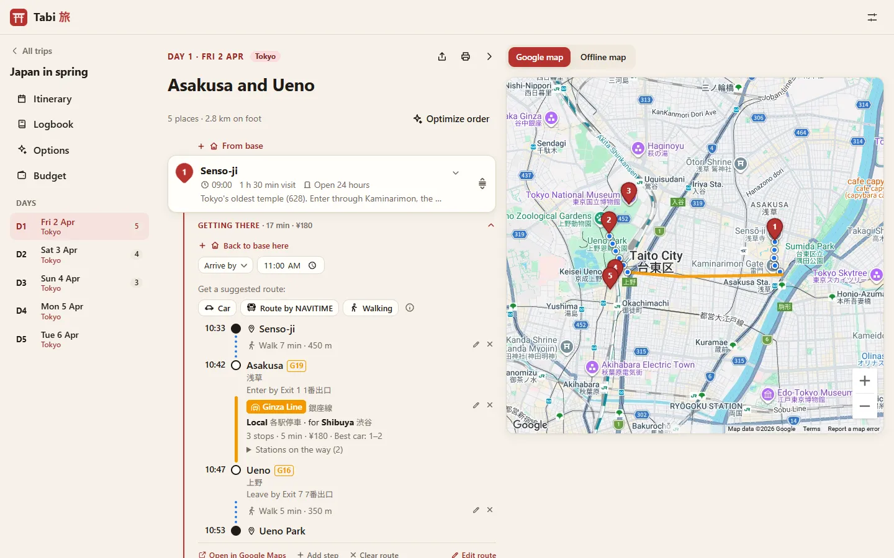
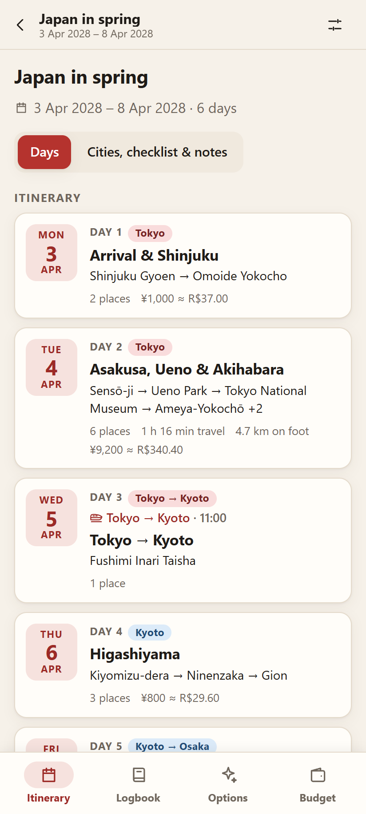
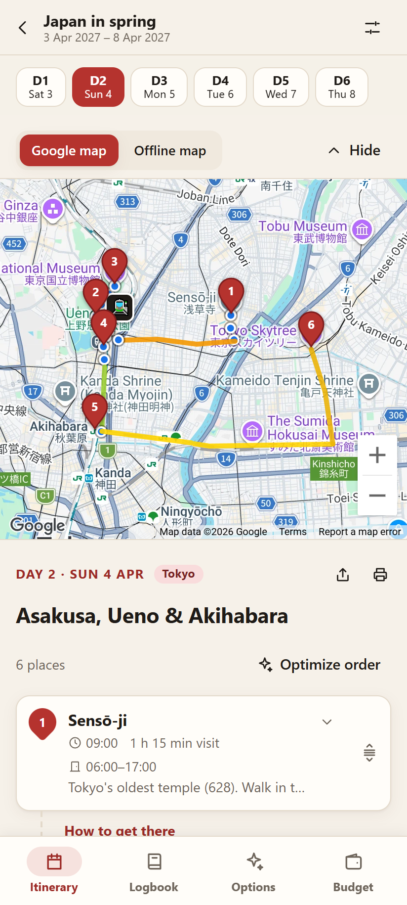
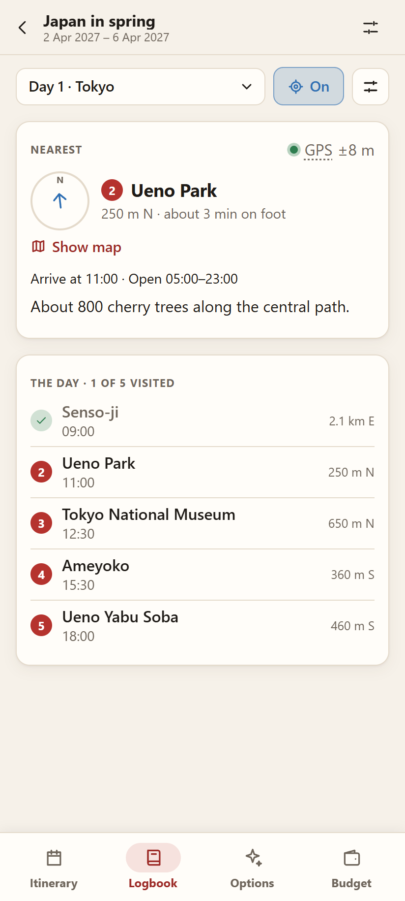
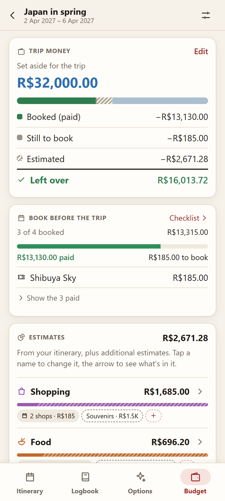

<div align="center">


# Tabi 旅

**Plan every step of a trip — and take it offline.**

Organize each day on a map, decide exactly how to get from one place to the next,<br>
keep notes and costs together, and carry everything in your pocket without internet.

[**Open the app →**](https://lydiagarcia03.github.io/tabi/)


<br>



</div>

> *Tabi* (旅) means "journey" in Japanese.

---

## ✨ What it does

<table>
<tr>
<td width="50%" valign="top">

### 🗺️ Days on a map
Each day is an ordered list of places, shown as numbered pins. Drag to reorder, add notes (history, tickets, tips), planned times and costs, and see how far you'll walk that day.

### 🚇 Exactly how to get there
Every leg A → B is a chain of steps, each with its own mode: *walk 7 min to Asakusa → Ginza Line to Ueno → walk to Ueno Park*. Ask for a suggested route by car, public transport or on foot (Google; public transport in Japan by NAVITIME) arriving by or leaving at a chosen time, or draw it on the map yourself. Open a leg to see only its route on the map and read it like a station timeline: times, station numbers (G19), the entrance and exit to use, the train type and where it's bound for, the stops on the way and the best car to ride.

### 🕘 Opening hours & best order
Type each place's hours and visit time. Tabi warns about visits that don't fit and suggests the best order for the day — computed on the device.

</td>
<td width="50%" valign="top">

### 🏨 Options & comparison
Collect the hotels, restaurants, places, shops and transport you're considering. Rate them, add prices and photos (browse them in a carousel), see them on a map, and compare them per city by price, distance and rating. Tick one and it goes into the itinerary: a place into a day, a hotel or a flight into the trip.

### 💴 Budget
Start from the money you set aside: what is already booked (paid), what still needs booking, and the estimates per category (the itinerary plus your own, like souvenirs), ending in what's left over. During the trip, log what you spend each day and see it against the estimate. Pay in the currencies of the countries you visit (yen, dollars…) and see it all in your own, with today's rate filled in and editable — or no conversion at all on a trip at home.

### 📴 Offline-first
Install it on your phone. Itineraries, notes, routes and costs stay readable without internet, with an in-app offline map, a GPS logbook (the place you're at with its notes and photos, a compass and the way to the next place on the map, a swipe to tick what you've visited), and KML/GPX export to Organic Maps.

</td>
</tr>
</table>

<div align="center">
<table>
<tr>
<td align="center" valign="top" width="25%">

<br><sub><b>The trip</b> — one card per day</sub>
</td>
<td align="center" valign="top" width="25%">

<br><sub><b>A day</b> — map and the way between places</sub>
</td>
<td align="center" valign="top" width="25%">

<br><sub><b>The logbook</b> — the day by GPS, offline</sub>
</td>
<td align="center" valign="top" width="25%">

<br><sub><b>The budget</b> — from the money set aside</sub>
</td>
</tr>
<tr>
<td align="center" colspan="4"><sub>On the phone: installed as an app, works without internet. The PC screens are in the animation at the top.</sub></td>
</tr>
</table>
</div>

### And also

- 🌍 **Made for Japan, ready for anywhere** — Japan gets the extras (NAVITIME routes, station names in English), but any trip works just as well: pick the countries, and their currencies come with today's rate, place searches look there first and Google suggests the public transport.
- 🏙️ **Cities** — split the trip by city (stays, day trips, stopovers), with a base hotel or station for each.
- ✈️ **Transport between cities** — flights with connections, shinkansen, buses; fares compared side by side, plus a flight planner and an airline baggage guide (Brazil → Japan, inside Brazil and Japan, and the biggest airlines of the Americas).
- ✅ **Checklist** — what the itinerary still needs booked (hotels, flights, tickets, tables), plus your own reminders.
- 🌏 **Japanese names in English** — station and line names translated from Wikidata, with the Japanese as written on the signs right under them.
- 🔗 **Open in Google Maps** — quick links for any place or leg when you're online.
- 🔄 **Sync between devices** — optional, through your own Google Drive (trips, photos and settings).
- 🌗 **Light & dark mode**, share or print a day, JSON backup to move a trip between PC and phone.

## 🧭 How it works

| Moment | Tool | Why |
| --- | --- | --- |
| Planning (online) | Google Maps Platform | Best place data (attractions, hotels, hours) |
| Route suggestions | Google Routes (car, walking, public transport outside Japan) · NAVITIME (public transport in Japan) | Google's Routes API returns no public-transit routes in Japan; NAVITIME is a Japanese routing provider |
| Exchange rates | Frankfurter (European Central Bank rates) | Free, no key; only fills in a rate you can change |
| During the trip (offline) | Tabi (PWA) + OpenStreetMap / Organic Maps | Google Maps can't show custom transit/walking routes offline |

**All trip data lives on your device.** There is no backend server and no account to create. Optionally, sign in with Google to keep your devices in sync through a hidden app folder in your own Google Drive.

## 🛠️ Tech stack

- [Vite](https://vite.dev/) + [React](https://react.dev/) + [TypeScript](https://www.typescriptlang.org/)
- [@vis.gl/react-google-maps](https://visgl.github.io/react-google-maps/) — Maps JavaScript API, Places API (New), Routes API
- [NAVITIME Route (totalnavi)](https://rapidapi.com/navitimejapan-navitimejapan/api/navitime-route-totalnavi) via RapidAPI — public-transit routing
- [MapLibre GL JS](https://maplibre.org/) + [OpenFreeMap](https://openfreemap.org/) — offline map
- [Frankfurter](https://frankfurter.dev/) — today's exchange rates (European Central Bank)
- [Dexie](https://dexie.org/) — local storage (IndexedDB)
- [vite-plugin-pwa](https://vite-pwa-org.netlify.app/) — installable, offline-ready app
- GitHub Pages + GitHub Actions — hosting and deployment

## 🚀 Getting started

### Requirements

- Node.js (LTS) and Git
- A Google Maps Platform API key (Maps JavaScript API, Places API (New), Routes API)
- *(Optional)* A RapidAPI key subscribed to NAVITIME Route (totalnavi), Basic plan

### Run locally

```bash
git clone https://github.com/LydiaGarcia03/tabi.git
cd tabi
npm install
```

Create a `.env.local` file in the project root (it is git-ignored — never commit it):

```bash
VITE_GOOGLE_MAPS_API_KEY=your-google-maps-key
# Optional: OAuth client ID for Google Drive sync (public, not a secret)
VITE_GOOGLE_CLIENT_ID=your-client-id.apps.googleusercontent.com
```

Then start the dev server:

```bash
npm run dev
```

The app opens at `http://localhost:5177/tabi/`. For the map to load locally, the Google key must allow the `http://localhost:5177/*` referrer.

The RapidAPI key is not an environment variable: enter it in the app's **Settings** screen. It is stored on your device (and in your Google Drive when sync is on).

### Build

```bash
npm run build
npm run preview
```

The production build installs a service worker (offline cache). To test it without affecting the dev server on port 5177, preview on another port: `npx vite preview --port 5178`.

### Using it during the trip

- **Install:** open the app on an Android phone in Chrome → menu ⋮ → *Install app*. Open it once while online; after that it works without internet.
- **Offline map:** on a day page, switch to **Offline map** and download the trip's area while online (on the phone, the Logbook reminds you and can download it too).
- **Organic Maps:** on the trip or day page, tap **Organic Maps (KML)** and open the file with [Organic Maps](https://organicmaps.app/) (download the country's map there beforehand).
- **Phone ↔ PC:** Settings → **Account & sync** → *Sign in with Google* on both devices: trips, photos and the NAVITIME key are kept in a hidden app folder in your Google Drive. Without signing in: **Backup (JSON)** on one device, **Import a backup** on the other. Tick *Include my NAVITIME key* to carry the RapidAPI key too (then keep that file private).

## 📦 Deployment

Every push to `main` builds and deploys the app to GitHub Pages through GitHub Actions.

The Google Maps key is passed to the build through the repository secret `VITE_GOOGLE_MAPS_API_KEY` (*Settings → Secrets and variables → Actions*). Maps JavaScript keys are always visible in the browser; the key is protected by its HTTP referrer and API restrictions in Google Cloud. The Drive sync OAuth client ID goes in the secret `VITE_GOOGLE_CLIENT_ID` (it is public too; its authorized JavaScript origins protect it).

## 💸 Keeping it free

Tabi is designed to run at **zero cost**:

- **Google Maps Platform** — usage stays within the monthly free usage per API; the key is restricted to this site and to three APIs, and daily quotas cap usage. Places and routes are stored locally so they are never fetched twice.
- **NAVITIME via RapidAPI** — Basic plan: $0, 500 requests/month with a hard limit (requests are blocked, never billed). Only called on an explicit tap.
- **Offline map** — OpenFreeMap tiles (free, no key), downloaded within its limits.
- **Exchange rates** — Frankfurter (free, no key, no account).
- **Sync** — Google Drive API (free, no billing) in the user's own Drive storage.
- **Hosting** — GitHub Pages (free for public repositories).

## 🗺️ Roadmap

- [x] **Transit spike** — compare Google and NAVITIME transit routes in Tokyo (NAVITIME wins)
- [x] **Core planner** — trips, days, place search, pins, notes
- [x] **Legs** — step editor, suggested routes and hand-drawn steps on the map, read as a station timeline
- [x] **Budget** — costs and totals in two currencies
- [x] **Offline & export** — PWA, KML/GPX for Organic Maps, JSON backup
- [x] **Polish** — redesign, mobile UX, dark mode, share and print a day
- [x] **Opening hours & optimized order** — hours and visit time per place, best visiting order for a day
- [x] **Planning workspace** — wide desktop layout, cities, options board with a map, budget by money, checklist
- [x] **Transport between cities & airline guide** — flights, shinkansen and more; compare airlines by baggage and comfort
- [x] **Countries & currencies** — trips anywhere: the countries' currencies with today's rate, place search by country, routes by car and Google public transport outside Japan
- [ ] **Logbook & offline map** — follow the day by GPS (compass, the way on the map, places ticked as visited), in-app OpenStreetMap map that works without internet *(testing on the phone offline)*

## 📜 Data and attribution

Map and place data © Google. Transit routes by NAVITIME JAPAN. English names of Japanese stations and lines from [Wikidata](https://www.wikidata.org/) (CC0). Offline map tiles by [OpenFreeMap](https://openfreemap.org/), © [OpenStreetMap](https://www.openstreetmap.org/copyright) contributors. Offline maps by Organic Maps. Exchange rates: European Central Bank reference rates via [Frankfurter](https://frankfurter.dev/).

<div align="center">
<br>
<sub>A personal project, built with the help of <a href="https://claude.ai">Claude</a>. 🌸</sub>
</div>
